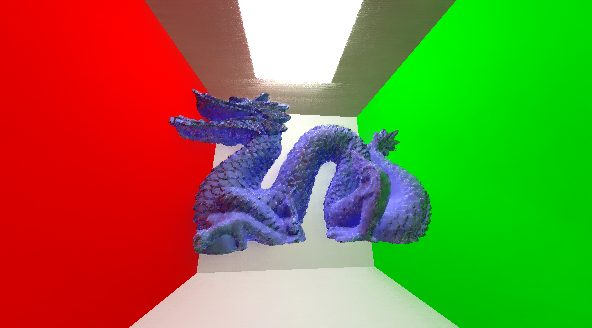

A standard hybrid renderer with progressive pathtracing.

For school, but I just took it as an excuse to make an awesome project. Following "Raytracing in One Weekend", but interpreted (in my own code) into C++ and OpenGL.

## Supports:
- Triangle intersection
- Bounding Volume Hierarchies
- Custom model loading
- Emissors
- Dielectrics (But not in denoising)
- Metals
- Lambertians
- UV albedo & roughness textures
- Smooth shading
- Spatiotemporal Variance-Guided Filtering (took a billion years)

Pass 1: Creating prior history buffer data

Pass 2: Makes G-buffers

Pass 3: Rasterizer pass (Direct light)

Pass 4: Pathtracer pass (Indirect light)

Pass 5: Combines both passes and gamma correction adjustment

Pass 6: Temporal accumulation of moment calculation

Pass 7: SVGF Denoiser

- First iteration calculates taps for disocclusion and integrated colour
- Next 5 perform the a-trous filtering and gaussian blurring

Basically finished except some visual bugs

Demo:

Triangles in scene: 67919

Another example image:
 

Specs:
CPU: AMD Ryzen 5 4500 6-Core Processor
GPU: NVIDIA GTX 1070
32 GB RAM

## How to build
Requirements: CMake version 4.0 or higher & Ninja
### Non-statically-linked build command:
Run `.\buildexe.bat`
This will build and create an executable in `bin`.
Run `.\bin\Raytracing.exe` in the origin folder (`raytracer\`)
### Statically-linked build command:
Add `--static` as a flag for `buildexe.bat`, so `.\buildexe.bat --static`